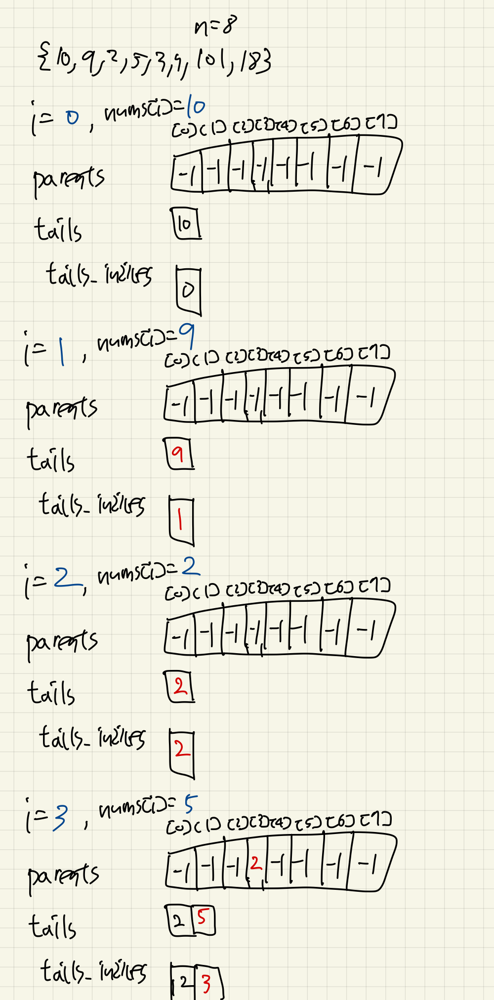
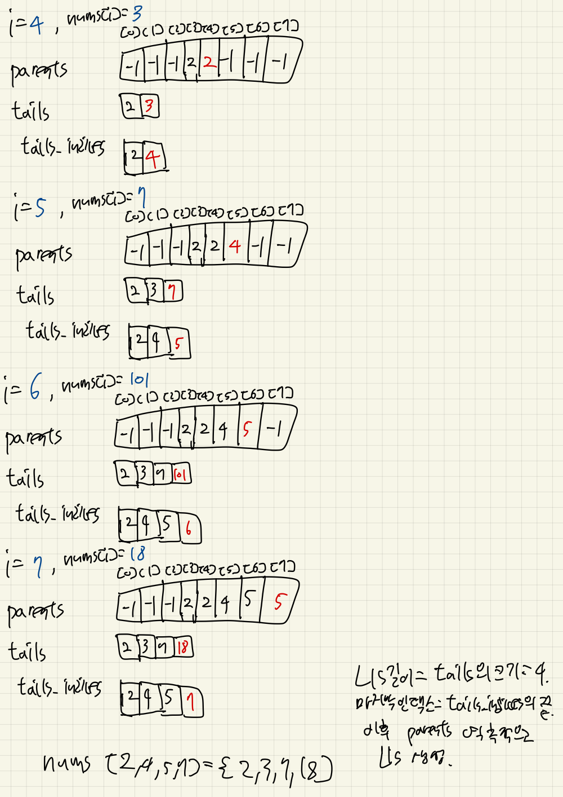

# LIS(Longest Increasing Subsequence)를 $O(n \log n)$에 복원하기

$O(n \log n)$에 LIS의 길이를 구하는 간단한 코드는 다음과 같다.

```cpp
vector<int> arr = {10, 9, 2, 5, 3, 7, 101, 18};
vector<int> lis;

for (int value : arr) {
  auto it = lower_bound(lis.begin(), lis.end(), value);
  if (it == lis.end()) {
    lis.push_back(value);
  } else {
    *it = value;
  }
}

cout << lis.size() << "\n";
```

그러나 `lis`는 길이를 구하기 위한 배열이며, 저장된 값들이 실제 LIS를 이루는 것은 아니다.

실제 LIS를 복원하는 코드는 `main.cpp`에 있다. 사용되는 배열은 다음과 같다.

- `tails`: 각 길이의 증가 부분 수열에서 가능한 가장 작은 끝값을 저장한다.
- `tails_indices`: `tails`에 저장된 값들의 원본 배열 인덱스를 저장한다.
- `parents`: 각 원소 앞에 오는 원소의 인덱스를 저장한다.

`nums`를 순회하며 다음을 반복한다.

1. 이진 탐색(`lower_bound`)으로 현재 값이 들어갈 위치 `pos`를 찾는다.
2. `pos`가 맨 뒤라면 새 길이의 증가 부분 수열을 찾은 것이므로 `tails`와 `tails_indices`에 추가한다. 그렇지 않으면 두 배열의 `pos` 위치를 갱신한다.
3. `pos > 0`이면 `parents[i] = tails_indices[pos - 1]`로 설정한다.

마지막으로 `tails_indices`의 마지막 인덱스부터 `parents`를 따라가며 LIS를 역순으로 채운다.

예제의 출력은 다음과 같다.

```text
Longest Increasing Subsequence: 2 3 7 18
```

아래는 실행 과정이다. `tails`가 항상 LIS 자체인 것은 아니므로, `parents`를 추적해야 한다.




