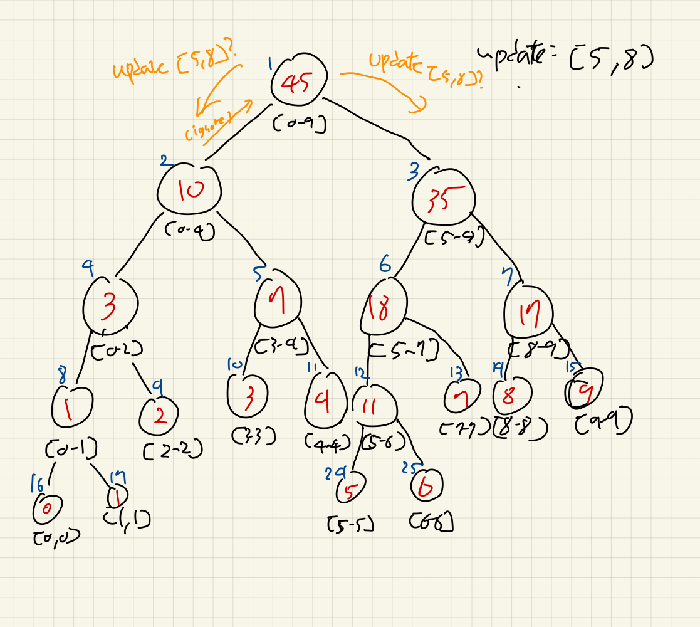
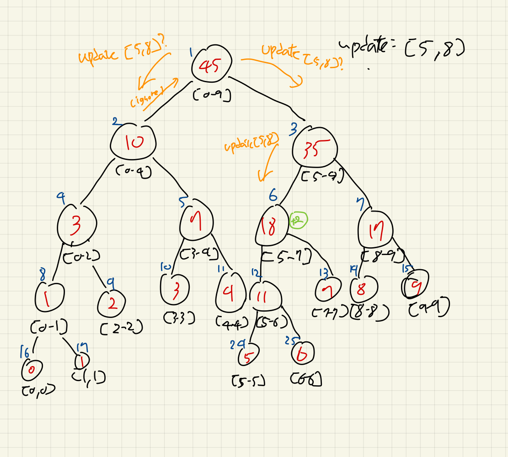
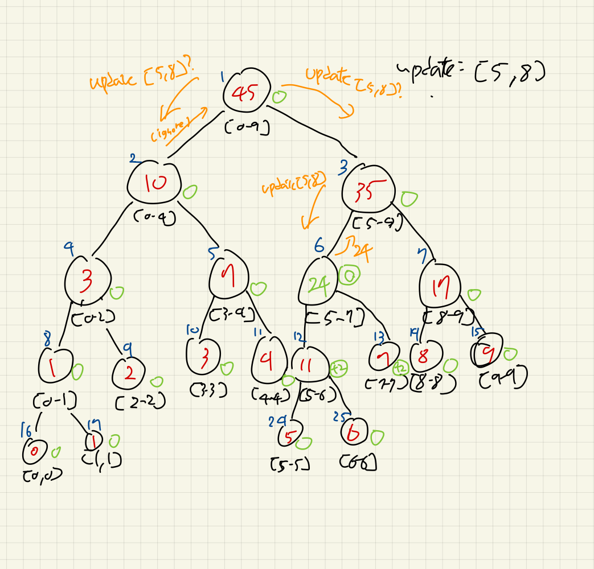
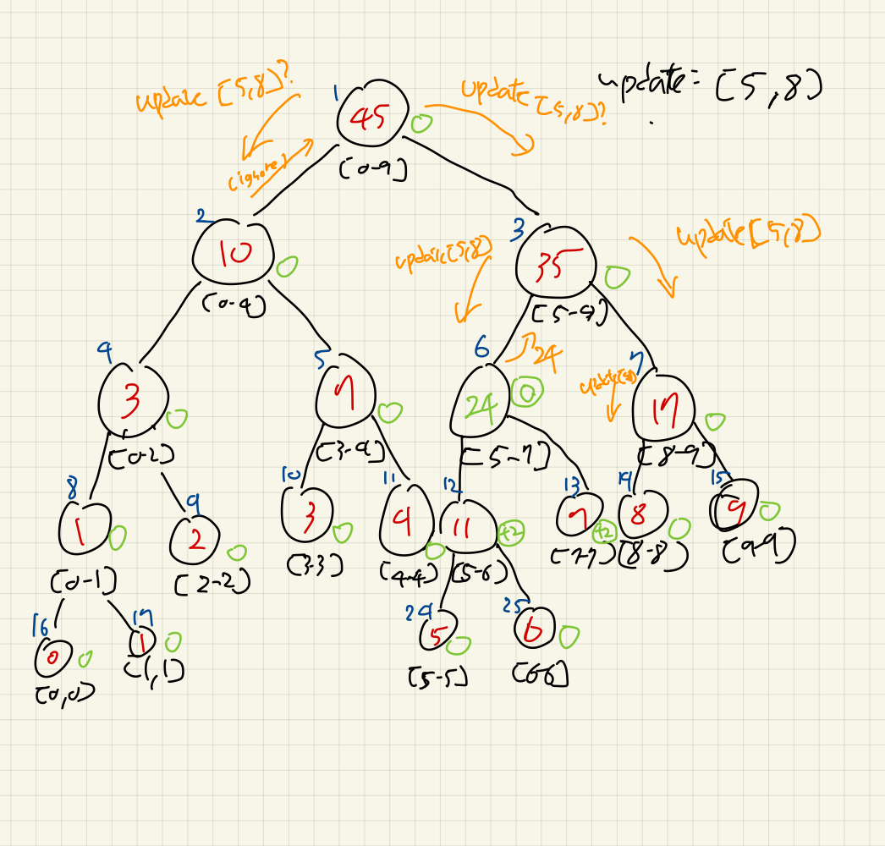
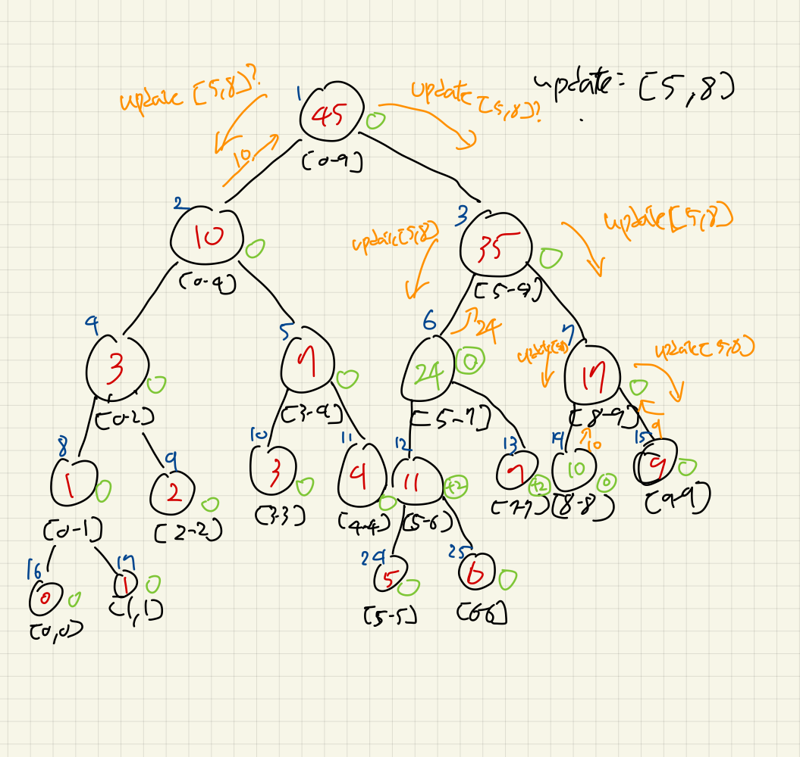
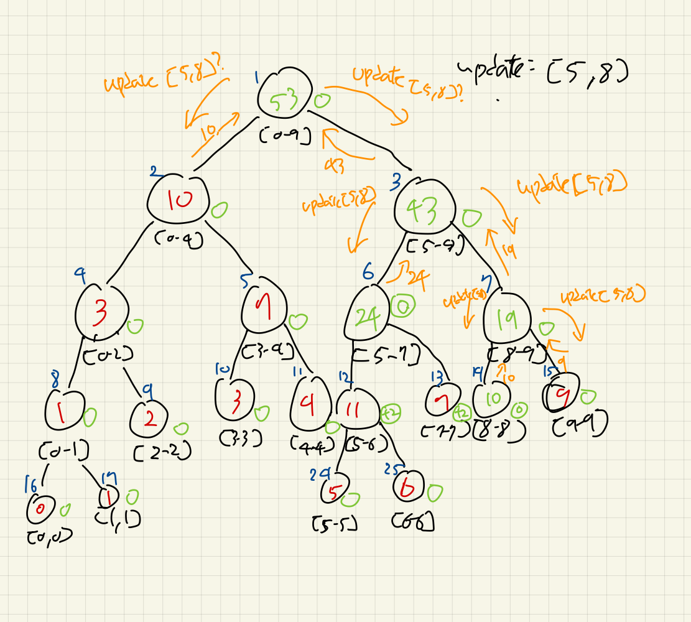
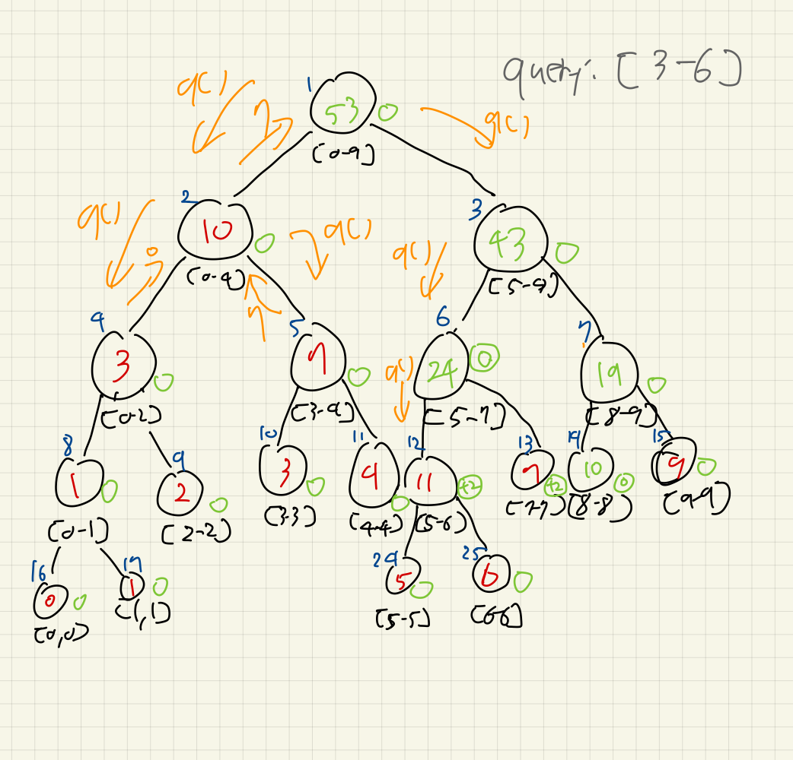
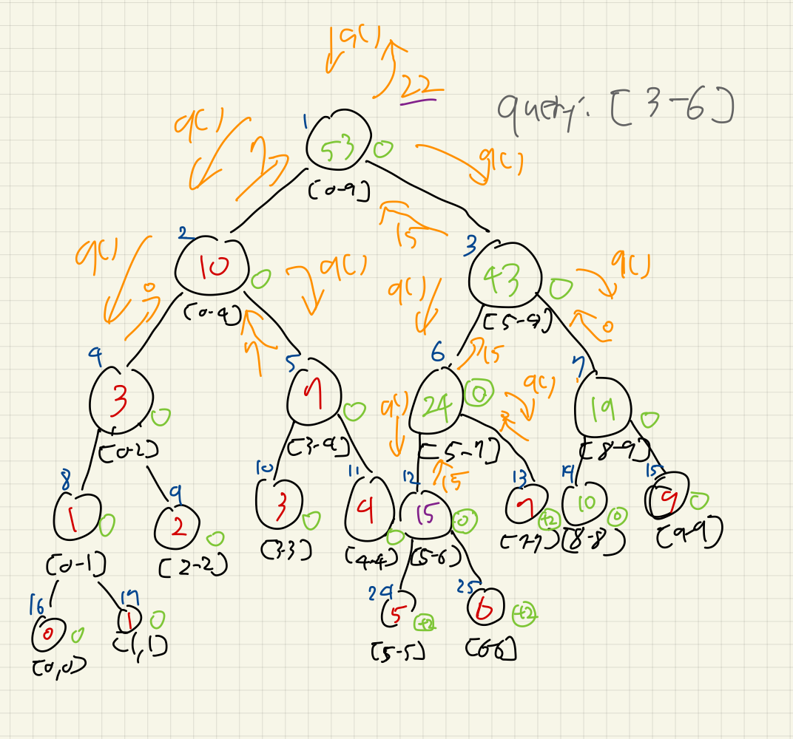

# Segment Tree (with Lazy Propagation)

세그먼트 트리를 통해 우리는 구간 연산에 대해 $O(log n)$으로 구할 수 있게 되었다.
이전의 업데이트는 단일 요소만 변경하였는데, 구간에 대해서 변경할 수 없을까?

$k$번 하는 경우, $O(k log n)$으로, 이는 너무 느리다.
대신, 가상의 lazy라는 트리를 이용해서 빠른 업데이트를 진행할 것이다.
당장 쿼리에 필요한 부분만 업데이트하고, 필요없는 부분은 업데이트를 미루는 방식이다.
lazy는 세그먼트 트리와 똑같은 모양으로, 값에는 나중에 업데이트를 반영할 누적값을 담을 것이다.

`lazy` 배열을 만들어준다. 세그먼트 트리와 대응되는 구조를 가진다.

```cpp
int arr[] = {0, 1, 2, 3, 4, 5, 6, 7, 8, 9}, seg[40], lazy[40];
```

## 수정된 `update()`

만약에, \[ql, qr\]구간에 대해서, `val`만큼 더한다고 가정해보자.
우리는 기존의 세그먼트 트리에서, 쿼리에 대해 어떻게 처리했는지 알 수 있다.
완전히 포함되는 범위에서 값을 리턴했었다.
lazy propagation도 유사하게, 완전히 포함되는 범위에서만 값을 업데이트하고, 서브트리에 대해서는 미룬다.

만약 \[5, 8\]구간에 대해 모두 +2를 하도록 업데이트를 요청한다고 해보자.
\[0, 4\]구간의 노드는 일단 자신이 미뤄둔 전파에 대해 업데이트를 반영하지만, 미뤄둔 변경사항도 없고, 아무것도 할 필요가 없어서 리턴한다.
\[5, 9\]에 대해서도 호출한다.
(지금은 전파 업데이트라는 말을 무시하자. 조금 뒤에 볼 것이다.)



우선, \[5, 9\]의 왼쪽자식인 \[5, 7\]부터 호출한다.
역시 이전의 미뤄둔 전파는 없어 하지 않는다.
그리고, \[5, 7\]은 \[5, 8\]에 완전히 소속된다.
여기서, 더 이상 내려가지 않고, `lazy`배열에 증가값 2를 넣는다.
노드 옆에 작게 쓰여진 초록색 노드가 `lazyw 가상 트리의 노드라고 보면 된다.



그 뒤, 전파 작업을 진행한다.

현재 `lazy`에 누적된 만큼 범위에 선반영을 해줄것이다. 하위 노드들의 연산을 하지 않고 말이다.
+2를 \[5-7\]의 범위에 하므로, `2*(7-5+1) = 6`, 즉 `6`이 증가된 것을 이 노드에서 선반영한다.
하위 노드들에는 아직 적용되지 않았다. 현재는 쓸 일이 없는 노드이므로, 더 미룰 것이다.
그래서, 두 자식 노드들에게 `lazy`값을 그대로, 즉 `2`를 물려준다.
`[5, 7]`에 붙어있던 +2가 아래 두 자식에게 전파되고, 노드 스스로는 값의 증가가 선반영됨을 확인하자.



이번에는 \[8, 9\]로 업데이트를 호출한다. \[8, 8\]부분 먼저 확인해보자.



포함되는 범위인 \[8, 8\]에 도착했다.
lazy에 값을 추가하고, 위에서처럼 똑같이 전파를 시도한다.
단, 이 노드는 리프 노드이므로, 자식 노드에 전파를 하지는 않고, 변경사항만 반영한다.
반대편 \[9, 9\]는 해당사항이 없는 범위이다.
lazy전파만 진행하고, 돌아온다.



이제 연쇄적으로 자식노드들이 완성되면서, 부모노드들의 업데이트가 한번 더 진행된다.
\[8, 9\], \[5, 9\], \[0, 9\]순서대로 자식들의 값을 참조하여 새로 반영한다.



설명에서는 일부 생략되어 전파가 유효한 범위에서만 되거나 내부 노드에서는 안 되는줄로 오해할 수 있지만, 혹시 모를 쌓여있는 `lazy`누적값들이 있을 수 있으므로, `update`함수 호출 맨 처음으로 전파를 진행한다.
이는 범위에 상관없이 호출된다.
그렇지 않으면, 잘못된 값이 남아있을 수 있다. 한 번 탐색된 노드에서는 우선 `lazy`값을 밀어내야 한다고 보면 된다.

코드 예시는 다음과 같다:

```cpp
void propagate(int index, int l, int r) {
  if (lazy[index] != 0) {
    seg[index] += lazy[index] * (r - l + 1);
    if (l != r) {
      lazy[index * 2 + 1] += lazy[index];
      lazy[index * 2 + 2] += lazy[index];
    }
    lazy[index] = 0;
  }
}

void update(int index, int l, int r, int ql, int qr, int val) {
  propagate(index, l, r);
  if (ql > r || qr < l) {
    return;
  }
  if (ql <= l && r <= qr) {
    lazy[index] += val;
    propagate(index, l, r);
    return;
  }
  int mid = (l + r) >> 1;
  update(index * 2 + 1, l, mid, ql, qr, val);
  update(index * 2 + 2, mid + 1, r, ql, qr, val);
  seg[index] = seg[index * 2 + 1] + seg[index * 2 + 2];
}
```

## 수정된 `query()`

여기서도 원칙은 같다.
범위가 유효하던 유효하지 않던, 현재 노드에서 쌓여있는 Lazy값들을 반영하고, 자식노드들에게 떠넘기는 전파작업을 먼저 하고,
그 이후로는 기존의 query작업과 같다.
이번에는 \[3, 6\]에 대한 구간합을 구해보자.
우선, \[3, 4\]구간에 대해서는 빠르게 생략했다.
바로 \[5, 6\]부분에 주목하도록 전과정을 건너뛴 모습이 아래 그림에 나타나져 있다:



이제, \[5, 6\]구간은 완전히 포함되는 구간이므로, 여기서의 `seg`값을 반환하면 되지만, `lazy`값이 있음을 알 수 있다.
우리는 방문한 노드에 대해서 반드시 `lazy`값으로 선반영하고 밀어내야 한다는 것을 알았다.
노드 값에 `2*(6-5+1) = 4`를 더하고, `lazy`값 `2`를 자식노드들에게 전파한다.
아래 그림은 전파 이후 상위 노드에 서브쿼리를 리턴하는 끝까지의 과정을 보인다.
쿼리 결과는 `7 + 15`로, `22`가 나온다.



쿼리 코드는 다음과 같다:

```cpp
int query(int index, int l, int r, int ql, int qr) {
  propagate(index, l, r);
  if (ql > r || qr < l) {
    return 0;
  }

  if (ql <= l && r <= qr) {
    return seg[index];
  }

  int mid = (l + r) >> 1;
  int lres = query(index * 2 + 1, l, mid, ql, qr);
  int rres = query(index * 2 + 2, mid + 1, r, ql, qr);
  return lres + rres;
}
```

## 전체 코드 확인

`main.cpp`를 보고 실행해보자.

```bash
Initial sum (0-9): 45
After update (5-8) += 2, sum (0-9): 53
Query (3-6): 22
```

## References

[https://www.youtube.com/watch?v=rwXVCELcrqU](https://www.youtube.com/watch?v=rwXVCELcrqU)
