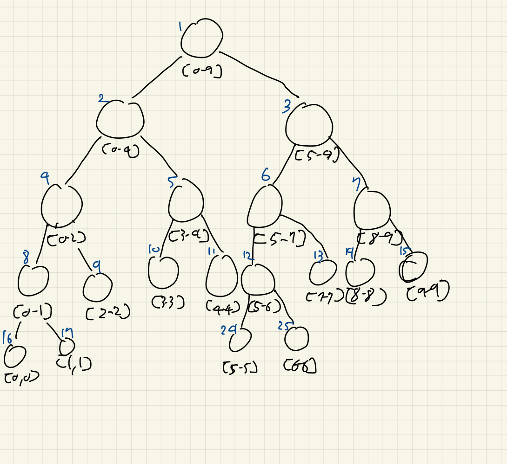
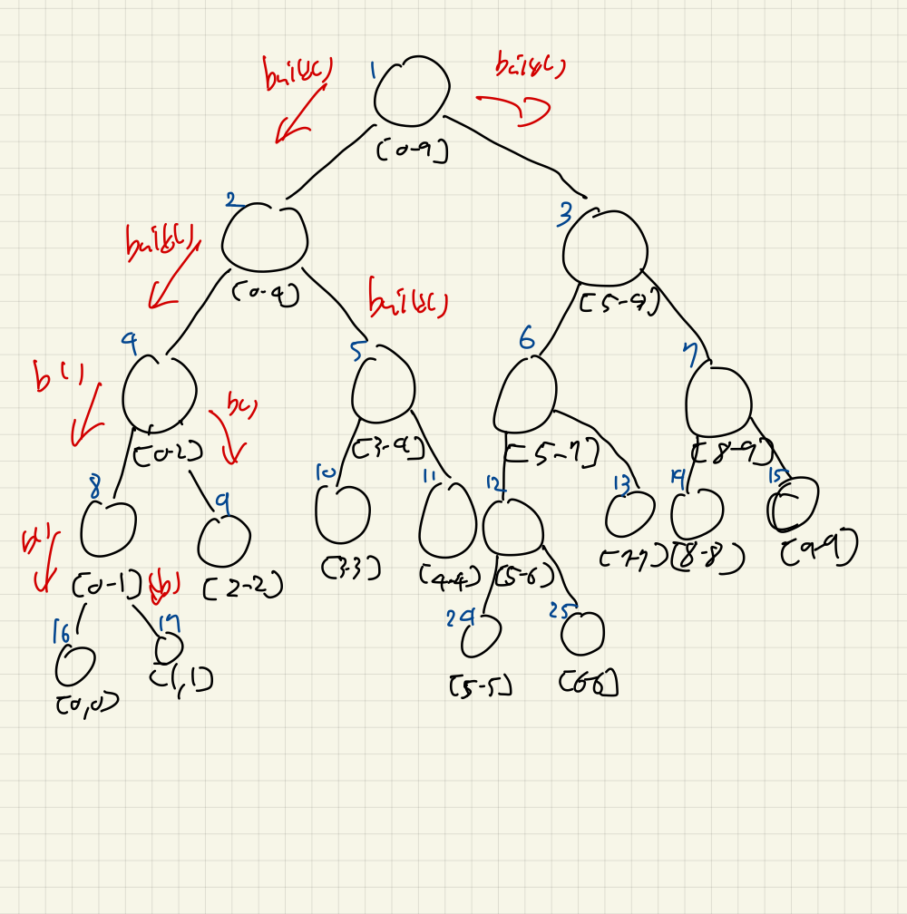
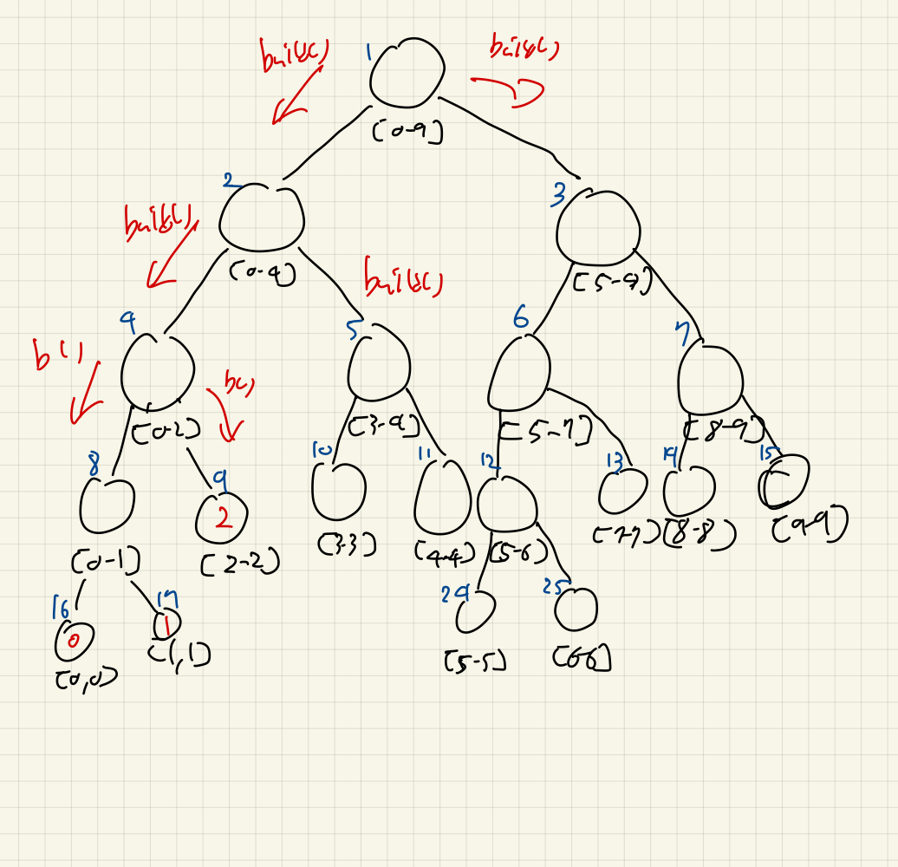
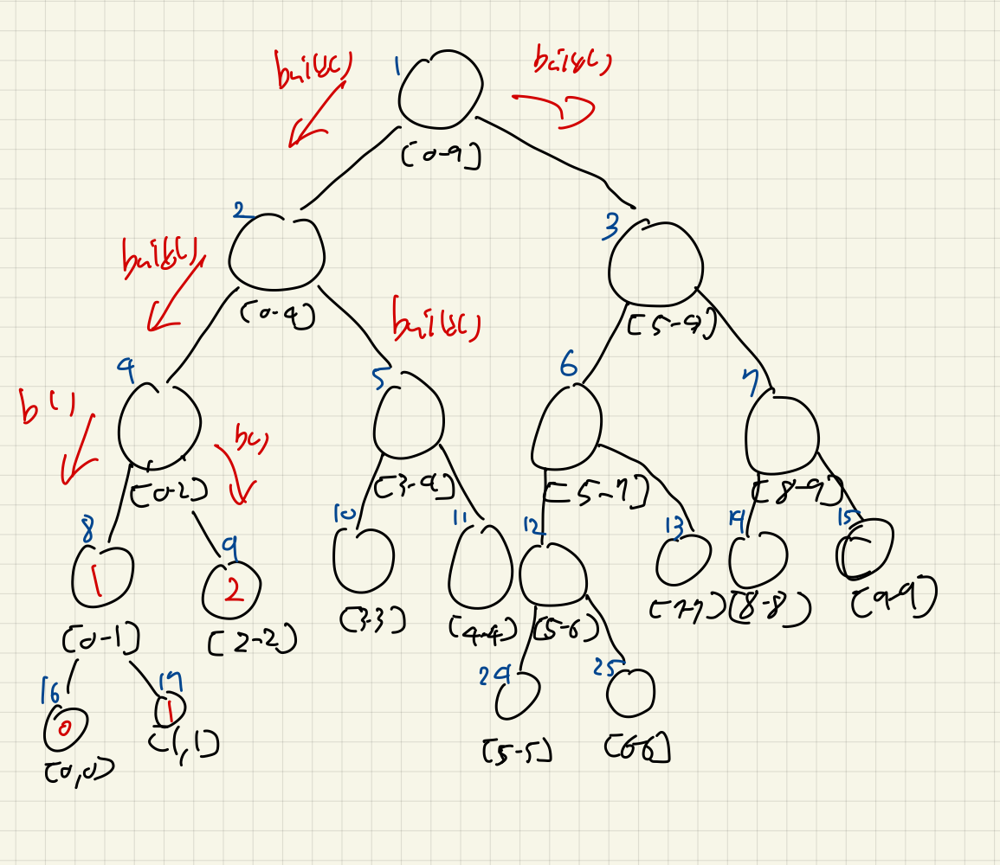
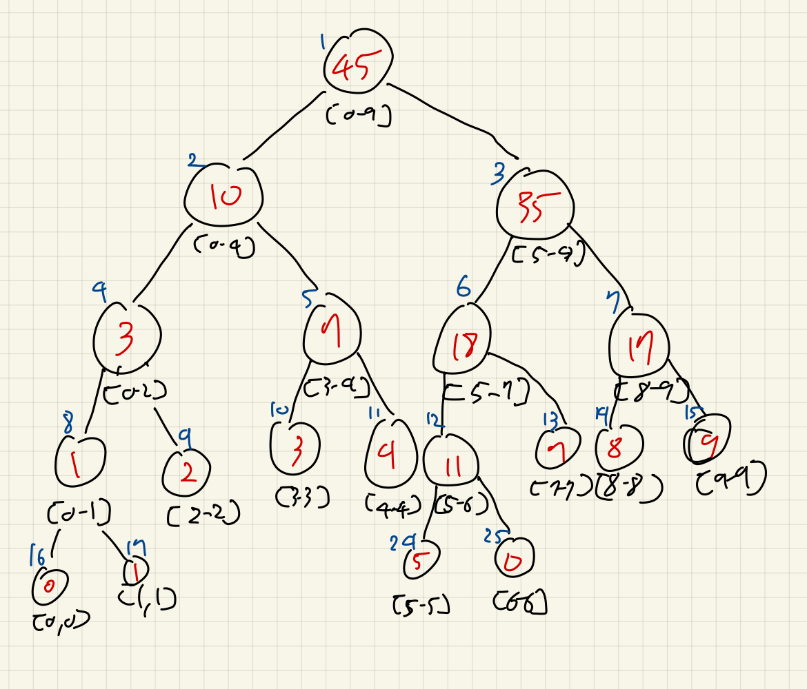
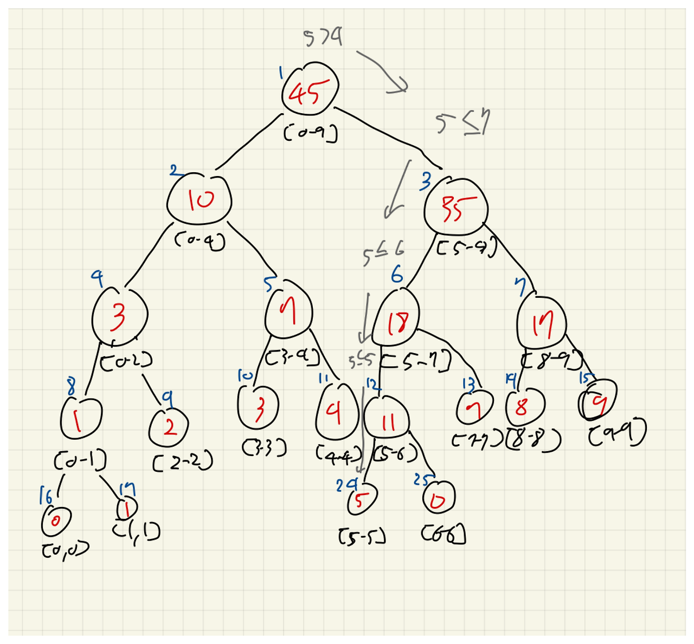
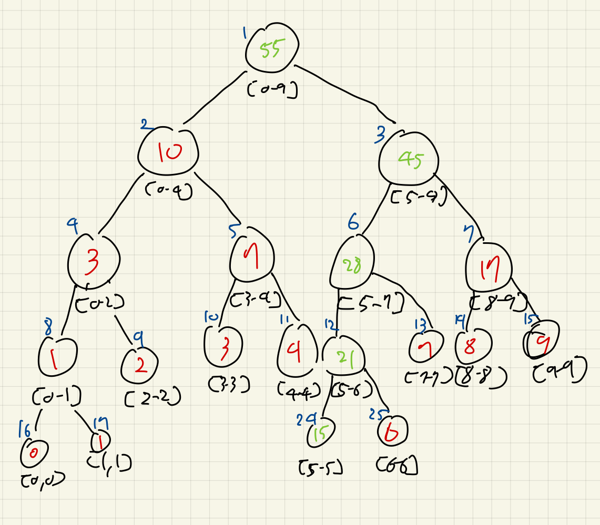
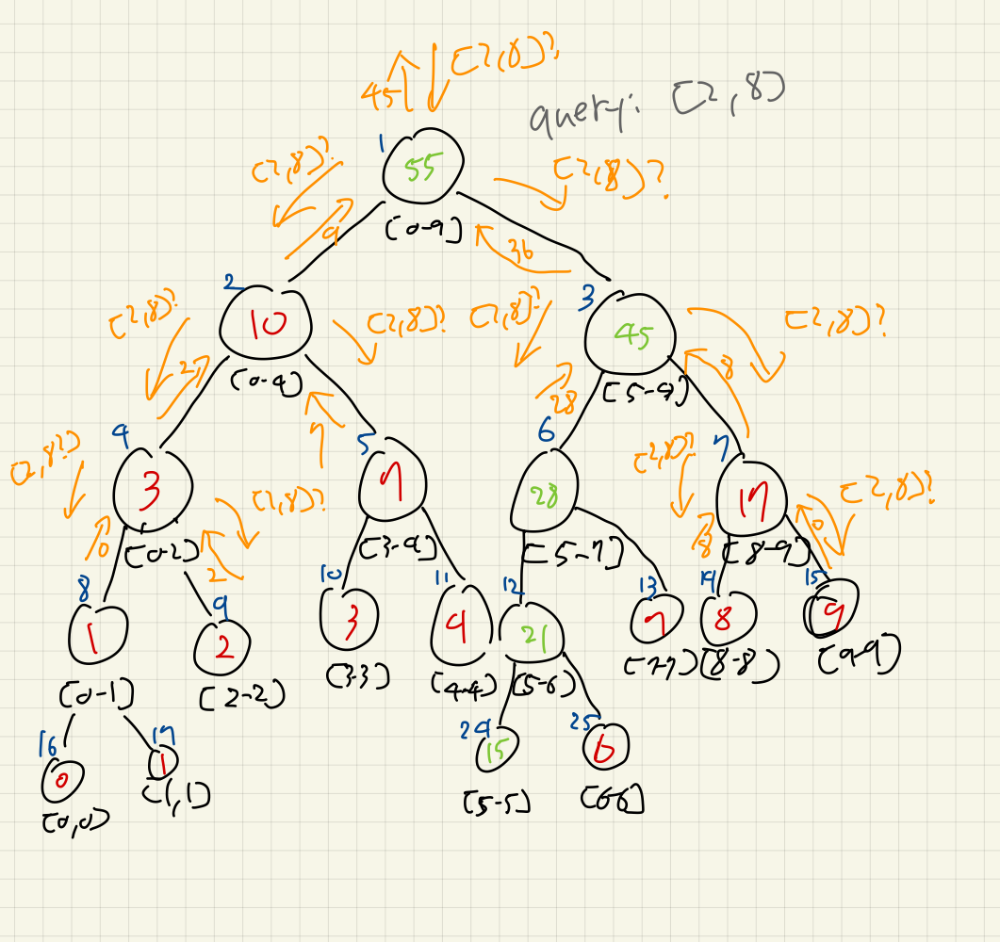

# Segment Tree

## 개요

세그먼트 트리란, 1차원 배열에서의 구간 연산에 대해 빠르게 구하는 자료구조이다.
구간 \[l, r\]에 대해서 기존의 naive하게 업데이트 및 연산하는 것은 $O(N)$의 시간이 걸리지만,
세그먼트 트리를 이용하면 $O(log N)$의 시간이 걸린다.

세그먼트 트리는 트리이지만, 배열 기반의 이진트리로 간단하게 표현될 수 있다.
이진트리의 특성상, 0-based의 기준, 인덱스 `i` 노드의 왼쪽 자식은 `i*2+1`, 오른쪽 자식은 `i*2+2`에 위치한다.
1-based의 기준, `i`노드의 왼쪽 자식은 `i*2`, 오른쪽 자식은 `i*2+1`이다.

세그먼트 트리에서, 루트 노드는 모든 구간에 대한 연산 결과를 저장한다.
왼쪽 자식노드는 루트 노드의 왼쪽 절반구간, 오른쪽 자식노드는 부모 노드의 오른쪽 절반구간에 대한 연산 결과를 저장한다.
리프 노드는 원본 배열의 값 하나를 저장한다.

우리는 배열의 크기가 `n`인경우, 완전 이진 트리를 가정하면 `2N-1`개가 되는데, 완전 이진트리가 아닐 수 있다.
특정 서브트리가 더 뻗은 형태일 수도 있다. 구현의 편리함을 위해서 `4n`으로 크기를 잡는다.
이는 안정적인 범위를 보장한다.
대신, 안 쓰는 공간들이 많아지기는 한다.



파란글씨는 인덱스, 노드 아래의 범위는 원본 배열 arr에 대한 범위를 나타낸다.
세그먼트 트리의 인덱스 4번은 구간\[0, 2\]에 대한
이제, 노드 안의 실제 값을 채워보자.

예를 들어서, 구간에 대한 합을 구한다고 가정해보자.
`arr = {0, 1, 2, 3, 4, 5, 6, 7, 8, 9}`를 가정할 것이다.
여기서는 0-based를 쓸 것이다.

다음과 같이 배열 arr과 seg를 가진다고 가정하자:

```cpp
int arr[] = {0, 1, 2, 3, 4, 5, 6, 7, 8, 9}, seg[40];
```

## 세그먼트 트리 초기화: `build()`

배열의 정보를 기반으로, 세그먼트 트리의 노드들을 채워보자.
여기서는 구간에 대한 합을 구하기로 했으므로, 각 서브트리의 루트는 양쪽 자식이 완성되어있어야 채워질 수 있다.
재귀를 이용해서 왼쪽 서브트리와 오른쪽 서브트리를 먼저 완성해야 한다.
루트에서 호출하면, 다음과 같이 자식들을 먼저 완성하기 위해 호출된다.
그렇게, 리프까지 닿게 된다. 여기서는 9번, 16번 노드와 17번 노드에 주목하자.



16번 노드와 17번 노드는 리프이다. \[l, r\]구간에서, `l == r`이다.
값을 업데이트하고, 탈출한다.



8번 노드는 이제 자식들이 완성되었으므로, 두 자식노드의 합을 구하면, 자신이 맡은 구간에 대한 합이 완성된다.



이제, 4번 노드도 양쪽 자식이 완성되었다.
각각의 서브트리들의 반대방향도 똑같이 이와 같은 과정을 거치면, 다음과 같이 완성된다:
**([6-6]구간에 0이 아니라 6이 맞다)**



구현은 다음과 같다:

```cpp
void build(int index, int l, int r) {
  // leaf
  if (l == r) {
    seg[index] = arr[l];
    return;
  }

  // internal
  int mid = (l + r) >> 1;
  build(index * 2 + 1, l, mid);
  build(index * 2 + 2, mid + 1, r);
  seg[index] = seg[index * 2 + 1] + seg[index * 2 + 2];
}

// build(0, 0, n-1);
// 전체 구간에 대해 arr로부터 seg 초기화
```

## 값 업데이트하기: `update()`

`arr`의 인덱스 `target`에 값을 `val`로 바꿨다고 가정하자.
배열을 바꾸고 `build`를 호출해도 되겠지만, 불필요한 빌드가 생기게 된다.

인덱스 5의 값이 15로 변경되었다고 가정하자.
우리는 이진트리의 특성으로 인덱스 5의 값이 원래 저장되어있던 리프 노드에 도착할 수 있다.
분할 정복으로, `mid`보다 작거나 같으면 왼쪽만 호출, `mid`보다 크면 오른쪽만 호출하면 최소한의 호출로 도달할 수 있다.



이제, 값을 업데이트하고 다시 재귀호출을 백트래킹하면서 부모노드들의 값을 업데이트해준다.



구현은 다음과 같다:

```cpp
void update(int index, int target, int val, int l, int r) {
  if (l == r) {
    seg[index] = val;
    return;
  }

  int mid = (l + r) >> 1;
  if (target <= mid) {
    update(index * 2 + 1, target, val, l, mid);
  } else {
    update(index * 2 + 2, target, val, mid + 1, r);
  }
  seg[index] = seg[index * 2 + 1] + seg[index * 2 + 2];
}
```

## 구간 연산 질의하기: `query()`

이제, 세그먼트 트리에서 구간합을 빠르게 구해보자.
\[2, 8\]구간에 대한 구간합을 질의해볼 것이다.

우선, 루트부터 보자.
루트는 \[0, 9\]구간의 합을 가지고 있다.
\[0, 9\]구간은 \[2, 8\]구간에 완전히 포함하지 않는다.
이런 경우, 양쪽의 서브트리에 나눠서 질의해야 한다.

\[0, 4\]구간과 \[5, 9\] 구간에 질의해보자.
\[0, 4\]구간역시 완전히 포함되지 않아서, 양쪽으로 쿼리를 추가로 나눠봐야 한다.
\[0, 2\]와 \[3, 4\]로 나눠서 질의한다.

\[0, 2\]구간역시 완전히 포함되지 않아서, 양쪽으로 쿼리를 나눈다.
\[0, 1\]구간과 \[2, 2\]구간으로 나눈다.

\[0, 1\]구간은 쿼리와 완전히 무관한, 유효하지 않은 구간이다.
우리는 합을 구하는게 목적이므로, 합과는 전혀 무관한 0을 반환하자.
어느 연산을 하느냐에 따라서, 어떻게 반환해야 할지가 달라진다.

\[2, 2\]구간은 \[2, 8\]구간에 완전히 포함된다. `seg[9(구간의 노드번호)]`를 리턴해서 자신이 책임질 수 있는 구간들의 합에 대해 반환한다.

\[3, 4\]구간은 완전히 포함된다. 똑같이 `seg[5]`를 반환해준다.
이제, \[0, 4\]구간에 질의해서 나온 하위 결과들이 도착했다. 두 질의결과인 `[2, 4]`의 구간합은 9이다.

\[5, 9\]에 질의해보자.
똑같은 과정을 거쳐서, \[6, 8\]에 대한 구간합인 36을 얻었다.

루트 \[0, 9\]에 대해서, 왼쪽 응답인 \[2, 4\]는 9를, \[5, 8\]은 36을 답했다.
이를 취합해서, \[2, 8\]의 합은 45임을 알 수 있다.
아래 그림에 세부적인 과정이 있다.



구현은 다음과 같다:

```cpp
int query(int index, int l, int r, int ql, int qr) {
  if (ql > r || qr < l) {
    return 0;
  }

  if (ql <= l && r <= qr) {
    return seg[index];
  }

  int mid = (l + r) >> 1;
  int lres = query(index * 2 + 1, l, mid, ql, qr);
  int rres = query(index * 2 + 2, mid + 1, r, ql, qr);
  return lres + rres;
}
```

## 전체 구현 확인 및 실행

`main.cpp`를 보고, 실행해보자.

```bash
Sum of range (2, 8): 35
Updating index 5 to 15...
Sum of range (2, 8) after update: 45
```

## References

[https://youtu.be/-dUiRtJ8ot0?si=SRjeBHChrzUaN-id](https://youtu.be/-dUiRtJ8ot0?si=SRjeBHChrzUaN-id)
